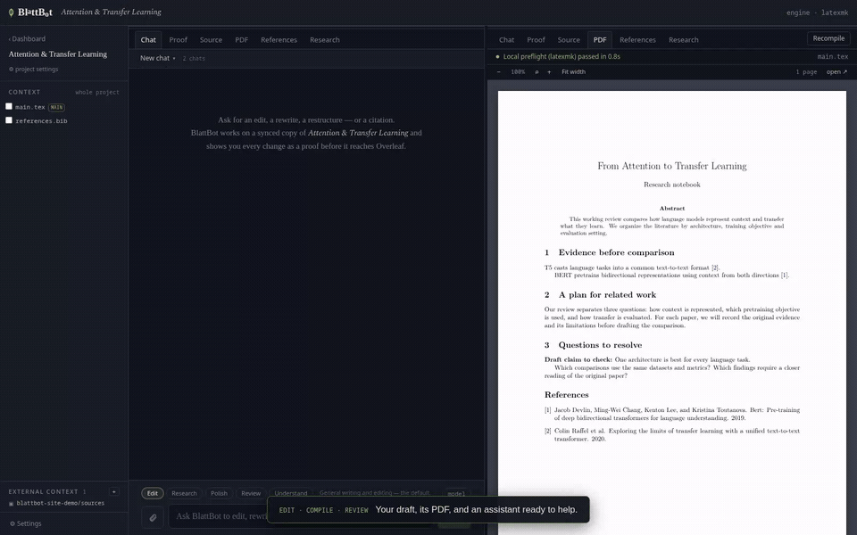

# 🍃 BlattBot (beta)

A local bridge and review layer for Overleaf projects. BlattBot mirrors a project into a git checkout on your machine and syncs it with **any** Overleaf instance — including Community Edition and self-hosted servers that have no git bridge at all, which it reaches through your existing browser session. Git-bridge instances and pure-local projects work too.

Every change, whether you typed it or the built-in agent made it, lands as a reviewable diff. Approving pushes it to Overleaf; nothing lands without your approval. Before a push, BlattBot checks the remote for changes made in the meantime: remote-only edits are absorbed, and a push that would overwrite someone's work is blocked until you resolve it. Document updates are applied in place over Overleaf's own realtime protocol, so comments, tracked changes, and per-document history survive a push.



[Watch BlattBot in action](https://blattbot.com/#demos) — a real agent edit, compilation, diff review and local approval, followed by editor and Research walkthroughs.

*Ask for a change, review the result, then approve it. Recorded in the current source build with a real agent; waiting periods shortened.*

```
Overleaf (any instance) ⇄ local git mirror ⇄ editor + Codex agent
                        ⇩
          you review the diff → approve → push
```

## Quickstart

```bash
npx blattbot
```

This starts the app on http://127.0.0.1:4560 and opens your browser. On first run BlattBot checks your environment and offers to download [tectonic](https://tectonic-typesetting.github.io) if no TeX engine is found. Run `npx blattbot --help` for flags and `npx blattbot doctor` to see what it detects.

You need Node 22.13 or newer (Node 24 LTS recommended), git, and the current [Codex CLI](https://developers.openai.com/codex/cli) installed and signed in:

```bash
npm install -g @openai/codex
codex login
```

**Codex is the default background harness.** BlattBot reuses your Codex login and configured model. Settings → Agent checks the connection and lets you choose a model or reasoning effort; **Check again** refreshes the model pickers too. Set `BLATTBOT_CODEX_EXECUTABLE=/path/to/codex` to use a custom installation. When launched from the Codex desktop app, BlattBot uses its bundled CLI via `CODEX_CLI_PATH`; otherwise it uses `codex` on your PATH. The integration uses the [Codex app-server protocol](https://developers.openai.com/codex/app-server), including its experimental dynamic-tool interface; keep the CLI up to date. Codex reports token usage, but does not supply a dollar cost.

Choose **Fast** in the chat toolbar or Settings → Agent → **Codex speed** to use [Codex Fast mode](https://developers.openai.com/codex/speed) on supported models. Fast mode uses more of your Codex allowance. **Standard** explicitly selects normal speed; **Codex default** inherits your CLI configuration. The saved choice applies from the next turn, including resumed chats and background helpers.

You can also select **Claude Code** (your existing login or an Anthropic API key) or an **OpenAI-compatible API** in Settings → Agent. Explicit backend choices are preserved; an empty backend setting now selects Codex. Changing backends starts a separate model conversation while keeping earlier messages visible in the chat. Global model settings and new project overrides are scoped to their harness. Background helpers such as paper summaries use the selected backend too; an incomplete configuration produces an error instead of silently switching providers.

The optional Claude backend runs through the Claude Agent SDK, which bundles its own copy of the Claude Code engine (a platform binary of about 230 MB). BlattBot does not install it by default. Select **Claude Code (Agent SDK)** in **Settings → Agent** and click **Install**: BlattBot downloads the version it is tested with into its data directory (`claude-agent-sdk/`). With a global `npm install -g blattbot`, you can instead run `npm install -g @anthropic-ai/claude-agent-sdk@0.3.278` next to it. Adding `--omit=optional` to that command skips the bundled engine; then set `BLATTBOT_CLAUDE_EXECUTABLE=/path/to/claude` to a `claude` binary you already have. The variable also works with a full install. `npx blattbot doctor` shows whether the SDK is installed and which engine is in use.

## Sync without clobbering

- **Automatic sync and connection notices.** Remote projects sync when opened, restored after a reload, or reconnected after a server restart. A failed sync or overlapping remote edits opens a popup and leaves a warning above the project panes, with retry, reconnect, or review actions. While an Overleaf project is visible, its account session is checked every minute and when you return to the tab. Dismissing the popup keeps the warning visible until sync succeeds; local-only projects do not sync.
- **Line-level merge.** A co-author editing other lines of a file you also changed no longer blocks anything. A sync commits Overleaf's version of the file and keeps your pending edits on top of it, so the agent always works on the current text. Approving merges the same way: the push carries the co-author's edits and yours, and edits you have not approved stay pending.
- **Drift detection and conflicts.** Approving a change first fetches a fresh snapshot from Overleaf. Only edits to the *same* lines (or a binary file, or a file deleted on one side) still block the push. The Proof tab marks such files "changed on Overleaf too" as soon as a sync finds them, and its conflict banner shows, per file, what Overleaf changed next to the original text and yours. For each file you can **Keep Overleaf's version** (drops your edits to that file only), **Resolve in editor** (writes both versions with `<<<<<<< yours` / `>>>>>>> Overleaf` markers into the file; approve refuses the file until the markers are gone), or **Overwrite Overleaf** (pushes your version of that file only, after backing up Overleaf's under `.git/blattbot/remote-backup/`, listed under **History → Overleaf backups** to view or download). Buttons that act on every listed file say so.
- **Selective merge.** Remote changes to files you have not touched are merged into your mirror as their own commit, both during a normal sync and after a push.
- **History.** The **History** tab lists every sync from Overleaf (or the git remote) and every approval as a timeline grouped by day, with author, files and line counts; click an entry to see its diff. Filter by **From Overleaf** to see what co-authors changed, or **Pushed by me** for your approvals. A badge on the tab counts incoming changes since you last opened it. **Revert…** writes the reverse of a commit into your files as new pending changes — edits made since are kept, overlapping ones get conflict markers and are reported — and you review and approve the result in Proof like any other change; nothing is pushed directly. Approval commits are authored with your global git identity (`git config --global user.name/user.email`) when it is set, sync commits as "Overleaf". The commit message defaults to the prompt of the agent turn that made the changes ("Agent: …") or "Manual edits"; Overleaf itself does not store commit messages, so for Overleaf projects they live only in BlattBot's history. Approval outcomes (pushed files, warnings, backups) stay in the chat after a reload.
- **"Overleaf changed" notice.** The minute check of the account session also reads Overleaf's project list. When the project changed since the last sync or push, BlattBot syncs on its own if nothing is pending and no agent turn runs; otherwise a small notice above the panes says "Overleaf changed at 14:05 · Sync now".
- **Cheaper turns.** Before each agent turn, one project-list request replaces the project download when Overleaf reports no change since the last full sync. A full sync still runs at least every 10 minutes and whenever anything is uncertain (no timestamp in the list, a local commit since, files left in conflict). Overleaf can report a co-author's typing a little late, so approving always checks a fresh snapshot.
- **Git-bridge conflicts.** When a sync leaves `<<<<<<<` conflict markers in a Git-bridge project, the agent does not start a turn until you resolve them; approve refuses them as well.
- **In-place updates.** Edited documents are updated through Overleaf's realtime protocol rather than deleted and re-uploaded, so entity ids are preserved and comments, tracked changes, and per-document history stay attached. If an in-place update fails, BlattBot falls back to a plain upload and tells you.

## Working with co-authors on Overleaf

For the common setup where you work in BlattBot and your co-authors work in the Overleaf editor:

- **Their review comments, in BlattBot.** The **Comments** button in the Source pane (Overleaf projects) lists the open comment threads on the project with the quoted passage, `file:line`, author and time of each message. Click a comment to open the file at that line. A comment whose quoted text is no longer in your local copy (you edited the passage) is marked *changed locally*. **Reply**, **Resolve** and **Reopen** act on Overleaf directly; tracked changes made by co-authors are listed below the comments. The list is cached until the next sync or push (or **Refresh**). Instances without Overleaf's comment API (older Community Edition) still list the comments, without their messages, and say so.
- **The agent can read them too.** Ask "address the reviewer comments in intro.tex": the agent's `list_overleaf_comments` tool returns the threads and tracked changes with `file:line`. It treats comments as co-author content (data, not instructions), and it cannot post, reply to or resolve anything; that stays with you.
- **Push as tracked changes (experimental).** In **Project settings**, *Push changes to Overleaf as tracked changes* makes approved edits to existing documents arrive as tracked changes (one per edited region), so co-authors can accept or reject them in Overleaf's review panel. It needs review permission on the project. New files, uploads (binary files, fallbacks) and deletions cannot be tracked; the approval result says so for each. Not every self-hosted instance records tracked changes: BlattBot checks after each document and warns "This Overleaf instance did not record tracked changes for …; the edit was applied as a normal edit" when it did not. If a tracked push fails, the document stays pending instead of being replaced as a whole file. The setting is off by default; with it off, pushes behave as before.
- **Label pushes in Overleaf's history.** In **Project settings**, *Label each push in Overleaf's history* adds a label with the commit message, for example "Agent: tighten the intro (BlattBot)", to Overleaf's History view after each approval. Co-authors then see what BlattBot pushed and can restore the version before it. BlattBot first asks Overleaf to move recent edits into its history, then labels the newest version. If the label cannot be added (older instances without the history API, or no permission), the push still counts and you get a warning. Off by default.
- **Newer Overleaf documents.** Documents stored in Overleaf's newer history format are edited in place too (with the same check that the text on Overleaf matches afterwards), so their comments survive. Tracked-change pushes do not support them yet and fall back to a normal edit, with a warning.
- **Compiler and main document.** On sync and push BlattBot reads the Overleaf project's compiler and main document. The main document becomes BlattBot's main file unless you picked one yourself.
- **Shared instructions: `blattbot.md`.** A `blattbot.md` file at the project root holds agent instructions for everyone on the project who uses BlattBot; it syncs through Overleaf like any other file. Because co-authors can change it, it is pinned by its SHA-256: the agent only uses a version you confirmed in **Project settings → Shared instructions** (**Use these instructions**). When the file changes, the agent keeps using the version you confirmed before (or none), and each turn shows "blattbot.md changed — review it in Project settings" until you confirm the new text. Only the first 4000 characters are used, and your own project instructions apply after it. **Create blattbot.md from my project instructions** writes the file as a normal pending change, so it goes through Proof and reaches Overleaf when you approve it.

## The agent

The agent works in the local git mirror and every turn ends in a diff you approve or discard. It compiles after editing and fixes its own LaTeX errors before showing you anything.

- **Citations.** A pipeline searches OpenAlex, Semantic Scholar, DBLP, and Crossref, fetches BibTeX, dedupes against your bibliography (by DOI and title), normalizes entries, upgrades arXiv preprints to the published version when one exists, and inserts the right cite keys. A deterministic audit checks every entry against Crossref/OpenAlex and badges it verified, unresolved, or mismatched.
- **Reference browsing.** Group references by shared authors, year, conference/journal, CORE conference rank, cited/unused status, publication type, or bibliography file. Groups collapse, work with search, and remember your choice per project. Sort papers by citation count, year, title, author, or usage within the project; sorting also works within groups and puts unknown values last. Shared-author groups connect matching full author names through coauthors, with each paper shown once. Venue details include sourced citation counts and, when a conference can be matched exactly, a linked CORE/ICORE rating with its edition. “No citations indexed” describes the selected index record, not proof that a paper has never been cited; coverage and version matching can be incomplete. Rankings come from the official portal's latest export, cached for a week; the displayed edition is not necessarily the paper's publication-year ranking. Missing or ambiguous matches stay unrated.
- **Reading papers for Related Work.** All backends can open individual references with `read_paper`, search their text, and follow page-labeled excerpts beyond the first context window. It uses an attached PDF (an exact cite-key filename, or a specified path), then an open-access PDF, then an abstract. Upload PDFs through **External context**; local source associations are remembered and checked against the current bibliography title. Abstract-only evidence, unavailable or mismatched sources, and unreadable pages generate visible chat notices. Changed citation passages whose papers were not opened in the turn are also flagged independently of the model's reply.
- **Rendered PDF diff.** Besides the text diff, the Proof tab can render the current and pre-change PDFs and highlight the pages and regions that visually changed — the latexdiff use case, without Perl.
- **Approve part of a diff.** Push changes as you confirm them: **✓** on a change approves just that passage, **approve file** a whole file. Everything else stays in Proof for later, with the same Overleaf conflict check as a full approval.
- **Edit in Proof.** Click **Edit** on a file or passage to revise it inside the Proof pane. The full editor supports autocomplete, undo, and Ctrl/Cmd+S; drafts stay in sync with Source. Save locally, return to the diff, then approve when ready.
- **External context.** Link the paper's codebase, an experiment folder, or a stack of PDFs (sidebar → External context → *Browse folders…*). The agent may read and grep them but never edit them, and they never sync to Overleaf. Each turn starts from a fresh listing of what those folders contain, so the agent can check the manuscript against the thing it describes — a formula against the implementation, a stated hyperparameter against the config, a reported number against the results — and is told to report a disagreement rather than quietly rewrite the text.
- **Git repository evidence.** Use **External context → Git repositories → Add repository**. Attach an HTTPS/SSH Git URL or a local Git repository and select a branch, tag or commit. BlattBot records an immutable commit snapshot, outside the manuscript. Private repositories use your existing Git credential helper or SSH setup; passwords/tokens in URLs and interactive login are unsupported. SSH hosts must already be trusted. Local uncommitted changes are excluded; use a linked folder when those changes are the intended evidence.
- **Cost transparency.** Every turn shows its cost (or token count), each project shows a running total, and a disclosure generator writes an AI-use statement from your actual usage logs — useful for venue and institutional AI policies.
- **Review mode.** A structured referee-report mode with a venue-style rubric; file edits are blocked in it.
- **Understand mode.** A read-only Q&A mode that explains the project's text, math, and arguments, grounding every answer in quoted passages from your files; file edits are blocked in it too.

## Research workspace

Open **Research** in either project pane. The writing tools are available to Codex, Claude and OpenAI-compatible backends.

- **Library:** search paper content with page-linked passages grouped by source. Detected bibliography sections are excluded by default; include them explicitly in search options. Match all meaningful words, an exact phrase, or any word. Optional agent term expansion helps with synonyms.
- **Reading:** read extracted text or original PDF pages alongside a notebook for each paper. Select a passage to anchor a note, record questions or summaries, and export notes as Markdown. Notes autosave with revision checks and offer undo after removal. **Check against paper** asks the selected agent to assess a saved note against relevant source excerpts. Verbatim quotations and page links accompany the assessment; note/source changes mark it stale. Suggested revisions require an explicit click and never replace notes automatically. Excerpt checks are not whole-paper verification.
- **Graph:** the default Research view automatically builds a directed citation graph for all existing projects at server startup and updates it after bibliography changes. Cached sources are reused; progress and unresolved lookups remain visible, with delayed retries for service failures. No model call is needed. Inspect project sources and external references. Arrows mean **A cites B**. Click nodes, expand their references, search, pan/zoom, inspect shared references, and find missing works ranked by how many project papers cite them. This ranking is a discovery aid, not a relevance/quality score. Newly imported DOI matches become project nodes. Unresolved records and failed lookups remain visible.

Codex can query the same persistent graph through `query_citation_graph`:

```json
{"query":"neighbors","node":"smith2020","direction":"outgoing"}
{"query":"shared_references","nodes":["smith2020","jones2021"]}
{"query":"missing","limit":20,"offset":0}
{"query":"path","node":"smith2020","target":"jones2021","maxDepth":6}
```

Keys and OpenAlex work IDs both identify nodes. Responses are structured JSON with provenance, coverage notices and pagination. `update_citation_graph` fetches pending project works or expands a selected node. Automatic indexing continues through all pending project entries in the background, sharing one worker across projects. Manual tool builds handle up to 20 pending entries (30 explicitly selected). Each paper contributes up to 1,000 references; saved graph views cap at 5,000 nodes/20,000 edges and show truncation. The canvas shows up to 80 nodes at once; queries use the full saved graph. An absent edge or path means **not found in the loaded index**, not that no relationship exists. Read a paper before using its citation relationship as a reason to cite it.

PDF page images prefer **Poppler** (`pdftoppm`) and fall back to PDF.js. OCR requires **Tesseract**. On Ubuntu/WSL, install both with `sudo apt install poppler-utils tesseract-ocr`; on macOS use `brew install poppler tesseract`. On Windows, install the native tools and add their executable directories to PATH. Override their paths with `BLATTBOT_PDFTOPPM` and `BLATTBOT_TESSERACT`. Reading provides text and original page views; the agent also supports OCR and visual figure/table inspection. OCR is cached by PDF content and page; only requested pages (plus the title page) are recognized. Visual interpretation requires an image-capable model in the selected backend. Verify recognized numbers and equations against the original image. Semantic search expands scientific synonyms and reranks source excerpts with the model; it is not an exhaustive semantic index.

OpenAlex credentials can be configured in Settings or via `OPENALEX_API_KEY`; they are sent only to OpenAlex. [Authentication](https://help.openalex.org/api/authentication/).

Research artifacts are saved locally under the BlattBot data directory. New checks and writing helpers use the selected model and may incur its normal usage costs. Run `npm run test:research-ui --workspace=server` after building to exercise the workflow against an isolated fixture model, with no paid calls.

### Recovering missing paper sources

`read_paper` tries attached PDFs and indexed open-access locations, then checks bibliography/repository landing pages, Crossref links and web search for author or publisher copies. A known public PDF or paper page can also be supplied with `url`. Downloaded content must match the bibliography title. Search snippets and generic page descriptions are not evidence. Publisher abstracts and book/chapter summaries retain their source URL and retrieval date, are labeled separately from full text, and do not substitute for full-text reading.

In **Settings → Agent**, **Save & test** stores a provider key on the running server before checking it. A key saved on another installation is not used here. Semantic Scholar requests are paced, short authenticated rate limits are retried, and alternate source providers remain available. An API key does not grant access to paywalled articles. An optional **Brave Search API key** enables authenticated web discovery; without it, public web search is attempted and may be blocked. Provider charges may apply. Failed searches report access errors without claiming that no public copy exists.

Unsuccessful source lookups are reused for five minutes to avoid repeated requests. `read_paper` with `refresh: true` retries immediately; changes to bibliography fields or provider credentials also invalidate that cache. Cached publisher text is reused for up to 24 hours and refreshed text invalidates affected evidence. A readable PDF supplied through **External context** remains the fallback when online sources cannot be retrieved.

### University and library access

Open **Settings → University access**, choose a publisher (or enter another public HTTPS website), and select **Open institution sign-in**. In the separate browser window, use the publisher's institution selector to choose your university or library and complete sign-in, including MFA. Return to the publisher site and select **Save publisher session** in Blattbot. The optional institution label is for your reference; no university is hardcoded and the publisher handles institution selection.

Blattbot stores only cookies that belong to the selected publisher host. Paper retrieval can use them on that exact HTTPS origin; general `read_url` requests stay anonymous. Cookies for other domains, including a separate university SSO site, and browser local storage are not saved. A saved session is not a verified subscription: title-matched PDF retrieval determines whether a particular paper is available. Reconnect to replace an expired session, or remove the connection to delete the stored cookies. Saving or removing a connection invalidates recent failed discovery lookups. Cached paper PDFs remain available after removal.

The login window requires a desktop display and an installed Chrome, Edge or Chromium on the machine running Blattbot; `BLATTBOT_BROWSER_EXECUTABLE` can select its executable. A login expires after ten minutes if unfinished. Sites that bind access to browser execution, require local storage, block automated requests, or require API access may still need a manual PDF download and attachment. ScienceDirect provides an [official institutional text-mining API](https://dev.elsevier.com/text_mining.html); university web sign-in is not equivalent to API entitlement. This feature does not purchase access or bypass publisher restrictions.

### Verify manuscript claims against a Git repository

For a local repository, choose **Add repository → Local folder → Browse folders…**. The picker marks Git folders, previews the current branch and commit, and recognizes repository roots when you open a subfolder. Use Home/Up, filter folder names, or paste a path (including `~/Projects`). It remembers the last selected folder and fills in the current branch automatically.

Select **Check code** in chat to audit manuscript claims against attached repositories. Add repositories under External context. The read-only agent explores the snapshots and returns source-linked assessments.

All three backends have the same `inspect_repository` tool:

```json
{"action":"list"}
{"action":"files","repositoryId":"<id>","commit":"<full SHA>","path":"src/","limit":80}
{"action":"search","repositoryId":"<id>","commit":"<full SHA>","query":"reduction"}
{"action":"search","repositoryId":"<id>","commit":"<full SHA>","query":"^def (loss|train)","searchMode":"regex","path":"src/","caseSensitive":true,"contextLines":3}
{"action":"read","repositoryId":"<id>","commit":"<full SHA>","path":"src/loss.py","startLine":30,"endLine":80}
{"action":"read_many","repositoryId":"<id>","commit":"<full SHA>","reads":[{"path":"src/loss.py"},{"path":"src/train.py","startLine":20,"endLine":120}]}
{"action":"compare","repositoryId":"<id>","commit":"<full SHA>","baseRef":"main"}
{"action":"history","repositoryId":"<id>","commit":"<full SHA>","baseCommit":"<base SHA returned by compare>"}
{"action":"diff","repositoryId":"<id>","commit":"<full SHA>","baseCommit":"<base SHA returned by compare>","path":"src/loss.py"}
```

File listings include hidden configuration, accept a `path` prefix and optional `query` filename substring, and support pagination. Search supports literal text (default) or POSIX extended regex, case-sensitive and whole-identifier matching, path prefixes, and up to ten context lines around each match. `read` uses one-based inclusive `startLine`/`endLine`; `offset` and `limit` are ignored. Large reads automatically page at 400 lines/40,000 characters, preserving exact source text and returning `nextLine`. `read_many` reads up to 20 related excerpts, reporting individual errors without losing successful reads. Its `nextOffset` continues the request list; each excerpt's `nextLine` continues that file. Search context and batch results also page by response size. Follow `nextOffset` and `nextLine`; search hits are leads, and the agent must read surrounding code before using them as evidence. Repository tool failures show concise explanations in chat, and successful reads show source ranges and continuation points.

`verify_code_claim` takes an exact manuscript quotation and selected Git line ranges with roles such as implementation, caller, configuration, evaluation, test or counterevidence. These evidence excerpts retain strict size limits: an assessment never silently substitutes a partial requested range. `list_code_evidence` retrieves saved assessments.

Assessments distinguish **implementation agrees**, **contradiction found**, **insufficient evidence**, and **execution required**. They retain manuscript hashes, full commit and blob identities, inspected excerpts, validated quotations and line numbers, the configured assessor backend/model, limitations and follow-up checks. Changing the manuscript or refreshing to a different commit marks affected assessments stale; previously fetched commits remain readable until the repository is removed. New versions of a claim's evidence retain earlier snapshot assessments.

This is static evidence review, not a reproducibility certification. No repository code, setup scripts or tests are executed. Empirical findings cannot receive a supported verdict from this tool, and code alone cannot prove a theoretical claim. The agent can miss relevant files, branches or claims, and a real quotation does not guarantee a correct interpretation. Unchecked claims remain unchecked; code assessments do not establish paper-citation support.

Ask **“What did this branch introduce compared with main?”** to inspect branch-only commits, changed files and per-file patches. `compare` fetches history from the attached source and pins the base revision; the attached branch tip stays at its recorded commit until you explicitly refresh it. Changes are measured from the common ancestor (merge base) to that tip, so changes made only on the base branch are excluded. `history` lists commits reachable from the tip but not the base. Merge commits may include merged work; this does not establish individual authorship. Reuse the returned `baseCommit` for subsequent `compare`, `history` and `diff` pages so a moving base branch cannot change the comparison mid-review. `offset`/`limit` paginate changed files, commits, or patch lines; follow `nextOffset` until null. Base and merge-base snapshots are also readable. Renames appear as deletion/addition; binary patches contain a notice rather than binary payloads. Unrelated histories, multiple merge bases and incomplete shallow-source history return explicit errors.

Snapshots initially fetch shallow history and include committed files only; requesting a branch comparison fetches complete history, which can take longer on large repositories. Submodules, symlink targets and Git LFS payloads are not fetched or followed. Reads reject binary files and files over 2 MiB; excerpts are limited to 400 lines/40,000 characters, and one assessment accepts up to 12 excerpts/90,000 characters. Git fetches time out after two minutes; source searches and comparisons have bounded time and output and report failure instead of presenting partial results as complete. Refreshes are explicit. Removing an attachment deletes its managed Git objects, preserves saved evidence as stale, and leaves the original repository untouched.

Run `npm run test:code-ui --workspace=server` after building the web app to exercise attachment, a full agent/tool/assessment loop, visible tool errors, batch reads, saved evidence, refresh invalidation and removal in a real browser using a fixture model. Set `BLATTBOT_BROWSER_EXECUTABLE` if Chromium is outside the usual locations. These fixtures test software behavior, not real-model scientific accuracy.

PDF equation, section, figure and citation links navigate to their embedded destinations inside the preview. Citation hover cards retain an **Open in References** action. This requires link annotations in the PDF (normally provided by LaTeX's `hyperref` package). Run `npm run test:pdf-links-ui --workspace=server` after building the web app to check reference navigation, keyboard access, zoom and resizing.

### Library indexing

Library indexing runs automatically with saved item checkpoints, progress and delayed retries. The Library view exposes pause/resume controls and retry actions for missing text. All model backends can inspect and control source indexing through `library_index`. The Evidence, Checks, Memory and Discover workflows are retired, and their model tools and code have been removed. Files they saved stay in the BlattBot data directory but are no longer read, except topic-match scores in citation graphs saved by older versions. Saved tasks of the retired kinds are kept but never run. Retired strict policies do not block draft approval or enter agent prompts.

### Search the paper library

**Research → Library** builds a persistent index of the complete extractable text of each project paper, within the PDF reader's limits (25 MB, 1,000 pages and five million characters per PDF). Search returns original passages with citation keys and page numbers. Optional synonyms/translations use the selected model. Ranking measures term relevance, not whether a passage supports a claim. Changed PDFs, OCR text or bibliography entries invalidate their index; outdated entries are excluded until refreshed. Abstract-only papers, missing sources and pages without readable text stay visible in coverage. Refresh explicitly to check for newly available remote full text. Image-only material needs OCR or visual inspection.

The same index is available to all backends through `search_library`:

```json
{"query":"generalization on unseen datasets","semantic":true,"limit":20}
{"query":"ablation","keys":["smith2020"],"offset":0}
```

### Find in source and PDF

**Ctrl/Cmd+F** searches the active Source or PDF pane. Source search handles literal LaTeX commands, live match counts, case/whole-word/regular-expression options and optional replacement with normal undo. Invalid expressions are reported. PDF search scans all pages, handles ligatures, whitespace and line hyphenation, and marks the exact selected text persistently while search is open. **Enter / Shift+Enter** moves forward/backward; **Escape** closes search. Case and whole-word options are available in both panes. PDF results are capped at 500 and source counts at 10,000, with `+` when more exist. Image-only PDF text needs OCR before it can be found.

### Source editor and project files

- **Autosave that never overwrites newer text.** Source saves 1.5 s after you stop typing (the **autosave** toggle in the status bar turns it off). Every save names the text you typed over. If an agent turn, a sync or a discarded change rewrote the file meanwhile, the save is refused and your draft stays, marked **changed on disk**: **Merge** combines both versions (passages both sides changed are marked as conflicts), **Save mine** writes your version over the file after a confirmation, **Revert** takes the file as it is. Autosave pauses while that notice shows, and a draft restored after a reload is not saved until you type in it.
- **Drafts survive a reload.** Unsaved drafts are kept in browser storage. The browser's leave prompt only appears when a reload would really lose something: a draft too large for storage, a save still running, or a running agent turn. Pending changes are files on disk and never trigger it. The open Source file and Proof's text/rendered choice are remembered per project.
- **New, rename, delete.** **+** above the file list creates a file; a path like `chapters/intro.tex` also creates the folder. Right-click a file or folder, or use a file's **⋯** button, to create a file there, rename or move it, or delete it (after a confirmation). These are pending changes like any edit: Proof lists them, **discard file** brings a file back, and nothing reaches Overleaf until you approve. File actions wait while an agent turn runs.
- **Main file.** **Project settings → Main file** picks the document BlattBot compiles, from the `.tex` files with a `\documentclass` line. A visible PDF rebuilds right away. Overleaf's own main-document setting is not changed.

### Projects at a glance

Dashboard cards and the sidebar show each project's kind (Overleaf, git, local), a running agent turn, how many files have pending changes, and the last sync when the server records one. The sidebar's project switcher lists the same. Overleaf projects have an **Open in Overleaf** link on their card, in the header and in the sidebar; it opens the project in a new tab.

### Keyboard shortcuts

Press **?** (or **?** next to Settings in the sidebar) for the list. The single keys work while the cursor is not in a text field or an editor, and never use Ctrl/Cmd/Alt, so browser and editor shortcuts are untouched: **c** focuses the chat composer; **1**–**7** show Chat, Proof, Source, PDF, History, References or Research; **j** / **k** (or **]** / **[**) jump to the next or previous change in Proof; **Shift+A** approves and pushes all changes after a confirmation, with the same checks as the button. To leave the Source editor with the keyboard, press Escape, then Tab.

## Honesty notes

- Reading and claim verification have limits: an excerpt is not a whole-paper read, PDF extraction does not interpret figures or image-only tables, and scanned PDFs need OCR/text or supplied passages. Long-paper claim checks use relevant excerpts and label that limitation. Source-reading notices expose gaps; they do not certify every generated statement as correct. When a Codex tool catalog changes, its native session is refreshed within the same BlattBot chat, carrying recent conversation text when available; the complete transcript stays visible.
- The local compile is a **preflight** using Tectonic (or your local TeX). Overleaf runs its own TeX Live, which can differ — the "Verify on Overleaf" button runs Overleaf's own compiler on the pushed state and shows you that PDF.
- Cookie-session sync drives Overleaf's internal web API, which is unofficial. It is primarily intended for Community Edition and self-hosted servers that have no git bridge; see [SECURITY.md](SECURITY.md).
- Your project text and the context you attach are sent to the model provider you configure (Codex, Anthropic via Claude Code, or an OpenAI-compatible endpoint). Check your venue's and institution's AI policy — the disclosure generator helps with that.

## Why not just Codex or Claude Code?

Codex or Claude Code in a folder can edit LaTeX. BlattBot adds what a bare CLI session doesn't have: sync with Overleaf instances that have no git bridge, a review/approval gate so no agent output reaches your document unchecked, entity-preserving pushes that keep comments and tracked changes alive, a compile preflight plus verification on Overleaf's own compiler, rendered PDF diffs, and a citation pipeline with deterministic auditing instead of model-remembered BibTeX.

## Connecting

Sign in once per Overleaf instance. The easiest way is "Sign in from browser session", which imports the login you already have in Firefox, Chrome or most other browsers. Inside WSL it reads the Windows browsers too; use Firefox there, since Chrome and Edge on Windows keep their cookies locked to the browser (app-bound encryption).

Instances with the git bridge (paid overleaf.com plans, Server Pro) can also be connected through a git URL.

## Environment variables

`npx blattbot --help` prints the same list.

| Variable | Purpose |
| --- | --- |
| `BLATTBOT_PORT` | Port to listen on (default 4560; `--port` wins). |
| `BLATTBOT_DATA_DIR` | Data directory (default `~/.local/share/blattbot`; `--data-dir` wins). |
| `BLATTBOT_CODEX_EXECUTABLE` | Codex CLI to use instead of the one on PATH. |
| `BLATTBOT_CLAUDE_EXECUTABLE` | `claude` binary for the Claude backend instead of the bundled one. |
| `BLATTBOT_BROWSER_EXECUTABLE` | Chrome, Edge or Chromium for the university sign-in window. |
| `BLATTBOT_PDFTOPPM` | Poppler's `pdftoppm`, for PDF page images. |
| `BLATTBOT_TESSERACT` | `tesseract`, for OCR. |
| `BLATTBOT_KWALLET` | KDE wallet holding the browser cookie key (default `kdewallet`). |
| `BLATTBOT_REVISION` | Revision reported by `/api/deployment` (unattended deployments). |
| `BLATTBOT_START_DRAINED` | `1` starts with new writes paused for up to two minutes (updates). |
| `BLATTBOT_HOME` | Home directory searched for browser profiles (default: yours). |
| `BLATTBOT_WSL` | `1` or `0` forces WSL detection on or off. |
| `BLATTBOT_WSL_MNT` | Where WSL mounts Windows drives (default `/mnt`). |
| `BLATTBOT_GIT_TOKEN` | Set by BlattBot for its own git processes; do not set it. |
| `HTTPS_PROXY`, `HTTP_PROXY`, `NO_PROXY` | Proxy for the tectonic download. |

## Security

The server binds to 127.0.0.1 only, checks the Host header on every request and requires a local auth token for the API, so other users and web pages cannot drive it. Secrets live in `~/.local/share/blattbot` with 0600 permissions. Treat that folder like `~/.ssh`. Overleaf cookies are only ever sent to your own Overleaf instance. The agent is blocked from running git commit or push. Details, including what data leaves your machine and how to revoke credentials, are in [SECURITY.md](SECURITY.md).

## Install from source

```bash
git clone https://github.com/LckyLke/blattbot.git
cd blattbot
npm install
npm run dev
```

The app then runs on http://127.0.0.1:4560, same as the npx version.

## Development

npm workspaces. `server/` is Fastify and TypeScript, `web/` is React and Vite.

```bash
npm install
npm run dev                            # rebuild frontend, then server on :4560
npm run dev:web                        # Vite dev server on :4561
npm test                               # unit tests
npm run check                          # typecheck + lint + unit tests (what CI runs)
npm run codex:check --workspace=server # installed Codex protocol check, no model turn
npm run verify:ui                      # browser checks against local mocks (no model, no TeX)
npm run test:ui --workspace=server     # full UI walkthrough without agent turns (needs TeX)
npx tsx server/scripts/e2e.ts          # full loop with a real agent turn
npm run release:pack                   # build and pack the npm tarball
```

`npm run dev` rebuilds the frontend once before starting the server. For live frontend updates while editing, also run `npm run dev:web` in a second terminal and open port 4561.

CI runs the suite on Ubuntu, macOS and Windows, and on the oldest supported Node. Release notes live in [CHANGELOG.md](CHANGELOG.md). See [CONTRIBUTING.md](CONTRIBUTING.md) for tests, checks and releases.

## License

Source-available under [PolyForm Noncommercial 1.0.0](LICENSE), Luke Friedrichs. Free for personal, academic, and other noncommercial use.

### Hosting behind an authenticated reverse proxy

Build the frontend with `npm run build --workspace=web -- --base=/blattbot/` (or another absolute path prefix), then `npm run build --workspace=server`. All API requests, WebSockets, PDF workers, downloads and logos follow that base. The default build still runs at `/`.

Keep the server on loopback. A proxy must authenticate the owner on **every** HTTP request and WebSocket upgrade, reject foreign-origin writes, remove the prefix, and send the loopback Host header. It may inject the local bearer token server-side; in that case, handle `/api/bootstrap` at the proxy without exposing the token. Keep user data in `BLATTBOT_DATA_DIR` outside releases and select the installed, authenticated Codex CLI with `BLATTBOT_CODEX_EXECUTABLE`.

For unattended deployments, the authenticated local `/api/deployment` endpoint reports the running `BLATTBOT_REVISION` and whether work is idle. `POST /api/deployment/drain` with `{"drain":true}` pauses new writes for up to two minutes while active requests, agent turns and research tasks finish. Only replace/restart an idle instance. Release a cancelled drain with `{"drain":false}`. Keep these deployment endpoints local. Build and test a pinned GitHub commit before activation; failed health checks must restore the previous code release without replacing user data.
